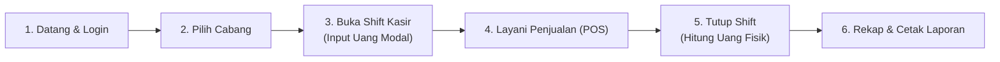

# 📘 Panduan Pengguna Abdi POS (User Guidelines)

Selamat datang di **Abdi POS**! 👋  
Panduan ini disusun khusus untuk membantu Anda—baik sebagai **Pemilik Usaha (Owner)**, **Manajer Cabang**, maupun **Kasir Operasional**—dalam menggunakan aplikasi kasir dan manajemen bisnis Abdi POS sehari-hari.

Bahasa yang digunakan di sini santai, ringan, dan langsung ke intinya agar Anda bisa langsung mahir tanpa perlu bingung dengan istilah teknis!

---

## 🧭 Daftar Isi
1. [Mengenal Antarmuka & Layar Utama](#1-mengenal-antarmuka--layar-utama)
2. [Alur Harian Kasir (Buka Shift hingga Tutup Toko)](#2-alur-harian-kasir-buka-shift-hingga-tutup-toko)
3. [Cara Melayani Transaksi di Layar Kasir (POS)](#3-cara-melayani-transaksi-di-layar-kasir-pos)
4. [Mengganti Cabang / Outlet (Multi-Cabang)](#4-mengganti-cabang--outlet-multi-cabang)
5. [Membaca & Memantau Data di Dashboard](#5-membaca--memantau-data-di-dashboard)
6. [Mengenal Notifikasi & Dialog Konfirmasi](#6-mengenal-notifikasi--dialog-konfirmasi)
7. [Tips Pintasan Keyboard (Biar Kerjanya Sat-Set!)](#7-tips-pintasan-keyboard-biar-kerjanya-sat-set)
8. [Panduan Khusus Superadmin (Pemilik Aplikasi POS SaaS)](#8-panduan-khusus-superadmin-pemilik-aplikasi-pos-saas)
9. [Panduan Masuk (Login) & Pengelolaan Profil Pengguna](#9-panduan-masuk-login--pengelolaan-profil-pengguna)
10. [Tanya Jawab Singkat (FAQ)](#10-tanya-jawab-singkat-faq)

---

## 1. Mengenal Antarmuka & Layar Utama

Saat Anda membuka aplikasi Abdi POS, layar terbagi menjadi 3 area utama yang sangat mudah dipahami:

```
+-----------------------------------------------------------------------------------+
|  [Logo Abdi POS]     [Martabak Nusantara / Dashboard]    [Outlet: Pusat v] [Buka POS F2] [🔔] [Profil v] |
+------------------+----------------------------------------------------------------+
|  MENU UTAMA      |                                                                |
|  - Dashboard     |   AREA KONTEN UTAMA                                            |
|  - Kasir (POS)   |   (Statistik Omset, Grafik Penjualan, Tabel Struk Kasir,      |
|  OPERASIONAL     |    Peringatan Bahan Menipis, dan Menu Terlaris)                |
|  - Transaksi     |                                                                |
|  - Shift Kasir   |                                                                |
|  MASTER DATA     |                                                                |
|  - Produk        |                                                                |
|  - Stok          |                                                                |
|  ...             |                                                                |
+------------------+----------------------------------------------------------------+
```

### A. Bagian Atas (Header Bar)
- **Nama Bisnis & Breadcrumb**: Menunjukkan nama tenant bisnis Anda (misal: *Martabak & Terang Bulan Nusantara*) serta posisi halaman yang sedang Anda buka.
- **Pemilih Cabang (Outlet Selector)**: Kotak biru yang menampilkan cabang yang sedang aktif. Anda bisa berpindah cabang kapan saja dengan mengkliknya.
- **Tombol Pintas "Buka POS" (F2)**: Tombol warna biru menyala di kanan atas untuk melompat langsung ke layar transaksi kasir.
- **Lonceng Notifikasi (🔔)**: Menampilkan pemberitahuan terkini, misalnya jika stok bahan baku hampir habis atau ada pembayaran QRIS yang baru masuk.
- **Profil Pengguna**: Menampilkan nama dan peran (*role*) Anda saat ini (misal: *Ahmad Najib - Owner & Admin*).

### B. Bagian Kiri (Sidebar Navigasi)
Berisi seluruh menu yang tersusun rapi:
- **Menu Utama**: Dashboard ringkasan, Kasir (POS), dan Demo Komponen.
- **Operasional**: Riwayat struk transaksi, pencatatan shift kasir, dan pesanan self-order meja.
- **Master Data**: Katalog produk makanan/minuman, kategori menu, persediaan bahan, dan data member.
- **Promosi**: Pengaturan diskon, promo bundling, dan tebus murah.
- **Laporan & Outlet**: Laporan omset keuangan dan daftar cabang Anda.
- **Pengaturan**: Domain bisnis dan paket langganan SaaS.

> 💡 **Tips Nyaman**: Jika Anda ingin layar terlihat lebih lega (terutama di layar tablet kasir), klik tanda panah kecil di samping logo Abdi POS untuk **menciutkan sidebar**.

---

## 2. Alur Harian Kasir (Buka Shift hingga Tutup Toko)

Agar pencatatan uang kas di laci tidak ada selisih, ikuti alur rutin berikut setiap hari:



### Langkah demi Langkah:
1. **Pilih Cabang Anda**: Pastikan di pojok kanan atas nama cabang sudah sesuai dengan tempat Anda bertugas hari ini (misalnya: *Outlet Pusat - Sudirman*).
2. **Buka Shift Kasir**: Masukkan jumlah uang modal awal (uang receh/kembalian di laci kas).
3. **Mulai Berjualan**: Gunakan menu **Point of Sale (POS)** sepanjang jam kerja.
4. **Tutup Shift di Akhir Hari**:
   - Di dashboard atau menu *Shift Kasir*, pilih **"Tutup Shift Kasir"**.
   - Akan muncul jendela konfirmasi peringatan berwarna kuning.
   - Masukkan hasil hitungan fisik uang tunai di laci kasir.
   - Sistem akan mencocokkan otomatis uang fisik dengan catatan transaksi. Jika ada selisih, sistem akan memberitahukan secara transparan.

---

## 3. Cara Melayani Transaksi di Layar Kasir (POS)

Untuk masuk ke layar kasir, klik tombol biru **"Buka POS"** di header atas atau cukup tekan tombol **`F2`** di keyboard Anda.

Layar kasir dirancang dengan dua kolom utama:
- **Sebelah Kiri**: Katalog Menu & Pencarian Produk.
- **Sebelah Kanan**: Keranjang Pesanan Aktif & Pembayaran.

### Alur Melayani Pelanggan:

#### 1. Menemukan Menu Pesanan
- **Gunakan Bar Pencarian**: Ketik sebagian nama produk (contoh: `"keju"` atau `"coklat"`), atau scan barcode produk menggunakan alat barcode scanner.
- **Gunakan Filter Kategori**: Klik tombol kategori di bawah kotak pencarian, misalnya tombol **"Terang Bulan"**, **"Martabak Telur"**, atau **"Minuman"** untuk menyaring menu dengan cepat.

#### 2. Memasukkan Menu ke Keranjang
- Cukup **klik kartu menu** yang diinginkan.
- Produk otomatis masuk ke keranjang di sebelah kanan, dan notifikasi hijau kecil akan muncul mengonfirmasi item berhasil ditambahkan.
- Ingin menambah jumlah? Klik tanda tambah `(+)` atau klik menu tersebut lagi. Ingin mengurangi? Klik tanda kurang `(-)`.

#### 3. Memeriksa Rincian Biaya
Sistem akan langsung menghitung secara otomatis:
- **Subtotal**: Total harga barang yang dipilih.
- **Pajak (PB1 10%)**: Pajak restoran yang berlaku (dihitung otomatis).
- **Total Tagihan**: Jumlah bersih yang harus dibayar pelanggan.

#### 4. Memilih Metode Pembayaran
Pilih salah satu dari 3 tombol metode bayar di bawah keranjang:
- **QRIS**: Untuk pembayaran non-tunai via aplikasi dompet digital (GoPay, OVO, Dana, BCA, dll.).
- **Tunai (Cash)**: Untuk pembayaran dengan uang tunai fisik.
- **Debit**: Untuk pembayaran kartu gesek / mesin EDC bank.

#### 5. Selesaikan Transaksi
- Klik tombol biru besar **"Bayar & Cetak Struk"**.
- Transaksi langsung tersimpan aman di sistem cloud, struk otomatis tercetak, dan keranjang siap melayani antrean pelanggan berikutnya! 🚀

---

## 4. Mengganti Cabang / Outlet (Multi-Cabang)

Jika bisnis Anda memiliki lebih dari 1 cabang (misalnya Cabang Sudirman, Cabang Tebet, dan Cabang Kelapa Gading), Anda tidak perlu login ulang untuk melihat data cabang lain:

1. Di header bagian atas, klik tombol **"Cabang Aktif"** (yang berikon toko).
2. Daftar seluruh cabang yang Anda miliki akan terbuka dalam menu tarik-turun (*dropdown*).
3. Klik nama cabang yang ingin Anda lihat.
4. Selesai! Seluruh data di layar (stok bahan, transaksi terakhir, grafik penjualan) akan langsung berganti mengikuti cabang yang baru Anda pilih.

---

## 5. Membaca & Memantau Data di Dashboard

Dashboard adalah ruang kendali bisnis Anda. Begitu Anda membuka aplikasi, 4 kartu utama langsung memberikan gambaran performa hari ini:

1. **Total Omset Hari Ini**: Jumlah seluruh uang masuk hari ini dari semua transaksi yang telah lunas.
2. **Jumlah Transaksi**: Berapa banyak struk atau pelanggan yang sudah berbelanja hari ini.
3. **Rata-rata Keranjang (Basket Size)**: Rata-rata nominal belanja per pelanggan (sangat berguna untuk mengukur efektivitas program *upselling* Anda).
4. **Kas Shift Berjalan**: Berapa banyak uang tunai fisik yang seharusnya ada di kasir saat ini.

### Widget Pendukung Lainnya di Dashboard:
- **Grafik Tren Penjualan**: Menunjukkan jam-jam tersibuk (*peak hours*) di toko Anda, sehingga Anda tahu kapan harus menambah staf dapur.
- **Peringatan Stok Menipis**: Memberitahu Anda bahan apa saja yang sisa stoknya sudah berada di bawah batas aman (misal: sisa tepung terigu atau keju). Segera lakukan belanja bahan jika item muncul di sini!
- **Menu Terlaris (Top Selling)**: Menampilkan ranking 1, 2, dan 3 menu favorit pelanggan Anda minggu ini.

---

## 6. Mengenal Notifikasi & Dialog Konfirmasi

Aplikasi Abdi POS sangat animatif dan komunikatif agar Anda tidak salah langkah saat mengoperasikannya:

### Jenis Notifikasi Toast (Pojok Kanan Atas)
- 🟢 **Hijau (Sukses)**: Berarti aksi Anda berhasil disimpan dengan sempurna (contoh: *"Transaksi #TRX-8921 berhasil dibayar"*).
- 🔴 **Merah (Error / Gagal)**: Ada masalah yang perlu diperiksa (contoh: *"Koneksi printer terputus"*).
- 🟡 **Kuning (Peringatan)**: Pengingat penting (contoh: *"Stok bahan tersisa sedikit"*).
- 🔵 **Biru (Informasi)**: Kabar sistem (contoh: *"Cabang berhasil dialihkan"*).

### Dialog Konfirmasi (Pop-up Keamanan)
Untuk tindakan yang tidak bisa dibatalkan—seperti **Membatalkan Struk yang Salah (Void)** atau **Menutup Shift Kasir**—sistem akan menampilkan jendela khusus dengan ikon berdenyut. Anda akan selalu diminta memastikan kembali pilihan Anda sebelum data resmi diubah.

---

## 7. Tips Pintasan Keyboard (Biar Kerjanya Sat-Set!)

Kasir yang handal bekerja dengan cepat! Gunakan tombol keyboard berikut:

| Tombol | Fungsi Cepat |
|---|---|
| **`F2`** | Langsung lompat ke Layar Kasir / POS dari halaman mana saja |
| **`ESC`** | Menutup jendela pop-up atau modal konfirmasi seketika |
| **`Tab`** | Berpindah ke kotak input berikutnya tanpa perlu menyentuh mouse |
| **`Enter`** | Menjalankan tombol konfirmasi utama |

---

## 8. Panduan Khusus Superadmin (Pemilik Aplikasi POS SaaS)

Bagian ini ditujukan khusus untuk **Anda selaku Pemilik (Founder / Superadmin) platform Abdi POS SaaS**. Anda memiliki hak istimewa untuk mengendalikan seluruh bisnis klien yang berlangganan pada aplikasi Anda.

### A. Cara Masuk ke Konsol Superadmin
1. **Melalui Sidebar**: Di bagian paling bawah sidebar navigasi mode toko, klik tombol berikon perisai **"Konsol Superadmin (Owner)"**.
2. **Melalui URL Langsung**: Anda dapat langsung membuka alamat URL: `http://localhost:5173/platform/dashboard`. Seluruh path berawalan `/platform/*` kini langsung dimuat dengan cepat dan stabil tanpa layar putih.
3. **Kembali ke Mode Toko / Kasir**: Saat berada di dalam konsol Superadmin, Anda dapat kembali kapan saja ke mode toko biasa dengan mengklik tombol **"Buka Portal Tenant"** di kanan atas header, atau tombol **"Masuk ke Mode Tenant"** di sidebar.
4. Tampilan konsol Superadmin didesain eksklusif dengan tema **Midnight Indigo & Deep Navy** untuk membedakannya secara visual dari mode operasional toko biasa.

### B. Membaca Ringkasan & Pertumbuhan SaaS (Platform Dashboard)
Di halaman **Ringkasan Platform (`/platform/dashboard`)**, Anda dapat memantau indikator bisnis SaaS Anda:
- **Monthly Recurring Revenue (MRR)**: Total pendapatan berulang bulanan dari semua tenant yang aktif membayar.
- **Total Tenant Terdaftar**: Berapa banyak brand/bisnis yang mendaftar di sistem Anda, berapa yang statusnya *Aktif*, dan berapa yang sedang dalam *Masa Trial*.
- **Total Cabang / Outlet Beroperasi**: Jumlah cabang fisik yang menggunakan aplikasi Anda di seluruh Indonesia.
- **Distribusi Tenant per Paket**: Grafik yang menunjukkan paket mana yang paling diminati oleh klien dan berapa omset yang dihasilkan dari masing-masing paket.

### C. Menambah & Mendaftarkan Tenant Baru
Saat ada klien bisnis baru yang ingin menggunakan aplikasi kasir Anda:
1. Buka menu **"Kelola Tenant"** (`/platform/tenants`) lalu klik tombol biru **"+ Tambah Tenant Baru"**.
2. Masukkan data identitas bisnis:
   - **Nama Bisnis**: Misal *Kopi Kenangan Senja*.
   - **Subdomain**: Cukup ketik kata kuncinya (misal *kopisenja*), sistem akan otomatis membuatkan URL `kopisenja.abdipos.com`.
   - **Custom Domain (Opsional)**: Jika klien punya domain sendiri (misal *kopikenangansenja.com*).
   - **Nama & Email Pemilik**: Kredensial login owner akan dikaitkan ke email ini.
   - **Pilihan Paket SaaS**: Pilih Starter, Business Pro, atau Enterprise Franchise.
   - **Masa Trial 14 Hari**: Centang opsi ini jika Anda ingin memberi masa percobaan gratis terlebih dahulu.
3. Klik **"Daftarkan Tenant Sekarang"**. Tenant baru langsung terdaftar dan dapat langsung mulai berjualan!

### D. Mengelola & Membekukan Akun Tenant (Suspend)
Di halaman **"Kelola Tenant"**, Anda dapat mengambil tindakan administratif pada setiap baris data:
- **Login sebagai Tenant (Impersonate)**: Klik tombol *Login* berwarna biru untuk masuk langsung ke tampilan toko milik tenant tersebut. Fitur ini sangat berguna saat klien meminta bantuan teknis (*customer support*) tanpa Anda perlu menanyakan password mereka!
- **Ubah Data Tenant**: Klik ikon roda gigi (*Settings*) untuk mengubah kuota cabang atau paket klien.
- **Bekukan Akun (Suspend)**: Jika klien belum membayar tagihan langganan setelah jatuh tempo, klik ikon segitiga kuning. Akun mereka akan dibekukan sementara hingga pembayaran selesai.
- **Aktifkan Kembali**: Begitu klien melunasi tagihan, klik ikon centang hijau untuk membuka kembali blokir akun dalam 1 detik.

### E. Membuat, Mengedit, dan Menghapus Paket Langganan
Buka menu **"Paket Langganan"** (`/platform/plans`) untuk mengatur katalog paket harga SaaS Anda:
1. **Membuat Paket Baru**:
   - Klik tombol **"+ Buat Paket Baru"**.
   - Masukkan nama paket (misal: *Paket Resto Franchise*), label badge (*"Eksklusif"*), harga bulanan (misal Rp 499.000/bln), dan diskon harga tahunan.
   - Tentukan kuota batasan: Maksimal Cabang, Maksimal Akun Kasir, dan Maksimal Menu Makanan.
   - Ketikkan daftar fitur (1 baris per fitur) yang akan tampil sebagai centang hijau.
   - Klik **"Terbitkan Paket Baru"**.
2. **Mengubah Konfigurasi Paket**:
   - Klik tombol **"Ubah Konfigurasi"** pada kartu paket yang ingin diperbarui (misal ingin menaikkan limit kuota atau menyesuaikan harga promo).
3. **Menghapus Paket**:
   - Klik ikon tong sampah pada paket yang ingin dihapus.
   - *Sistem Keamanan Pintar*: Jika paket tersebut masih digunakan oleh tenant aktif, sistem akan otomatis menolak penghapusan demi melindungi integritas data pelanggan Anda.

### F. Memeriksa Tenant Mana Saja yang Membeli Setiap Paket
Di bagian bawah halaman paket langganan, terdapat tabel **"Daftar Tenant Berdasarkan Paket yang Dibeli"**. Klik tab nama paket (Starter / Pro / Enterprise) untuk melihat daftar nama toko, nama pemilik, kontak email, dan tanggal jatuh tempo mereka secara transparan.

### G. Memantau Status DNS & Domain Klien
Buka menu **"Domain & DNS SaaS"** (`/platform/domains`) untuk memastikan seluruh alamat website dan subdomain tenant terhubung dengan aman. Jika klien baru saja mengarahkan DNS domain kustom mereka, klik tombol **"Verifikasi Sekarang"** untuk mengaktifkan sertifikat keamanan SSL (HTTPS) secara instan.

### H. Memeriksa Rekam Jejak (Audit Logs)
Buka menu **"Audit Logs Aktivitas"** (`/platform/audit-logs`) untuk memantau rekam jejak setiap aksi krusial yang pernah dilakukan di sistem (siapa yang mendaftarkan tenant, kapan paket diubah, alamat IP, dan waktu eksekusi).

---

## 9. Panduan Masuk (Login) & Pengelolaan Profil Pengguna

### A. Masuk ke Aplikasi (Login)
Buka URL **`http://localhost:5173/login`**.
- **Fitur Akun Demo Instan (1-Click Switcher)**: Di bagian atas formulir, klik tombol pill profil yang Anda inginkan:
  1. **Owner & Admin** (*Ahmad Najib*): Langsung mengarahkan ke dashboard utama bisnis.
  2. **Kasir Operasional** (*Siti Rahmawati*): Langsung mengarahkan ke antarmuka kasir cepat (POS).
  3. **Superadmin SaaS** (*Founder Abdi POS*): Langsung mengarahkan ke Konsol Superadmin (`/platform/dashboard`).
- Anda juga dapat mengetikkan email dan sandi pribadi secara manual, mencentang opsi **"Ingat saya"**, atau menggunakan tombol **"Lupa Kata Sandi?"**.

### B. Mengakses Halaman Profil Pengguna
Anda dapat membuka halaman profil melalui dua cara mudah:
1. **Dari Header Atas**: Klik kotak profil Anda di pojok kanan atas, lalu pilih **"Lihat Profil Saya"**.
2. **Dari Sidebar Kiri**: Di kelompok menu *PENGATURAN*, klik menu **"Profil Pengguna"** (`/app/profile`).

### C. Mengubah Data Profil (Nama, Kontak, & Foto Avatar)
1. Di halaman profil atau melalui dropdown header, klik tombol biru **"Ubah Profil"**.
2. Jendela pop-up modal akan muncul:
   - **Ganti Foto Avatar**: Klik salah satu foto preset yang tersedia atau ketikkan URL foto kustom Anda.
   - **Nama Lengkap & Kontak**: Sesuaikan nama, email, nomor WhatsApp, serta alamat tempat tinggal Anda.
   - Klik **"Simpan Perubahan"**. Notifikasi hijau akan muncul dan profil langsung terbarui seketika!

### D. Mengubah Kata Sandi Akun
1. Klik tombol **"Ganti Password"**.
2. Masukkan kata sandi lama Anda.
3. Masukkan kata sandi baru. Sistem dilengkapi dengan **Meter Pengukur Keamanan Sandi (Strength Meter)**:
   - Baris warna akan bergerak dari merah (lemah), kuning (sedang), hingga hijau (sangat kuat).
   - Pastikan memenuhi 3 kriteria keamanan: minimal 8 karakter, kombinasi huruf besar/kecil, dan angka/simbol.
4. Ketik ulang sandi baru pada kolom konfirmasi lalu klik **"Perbarui Kata Sandi"**.

### E. Keluar Akun (Logout)
Klik tombol merah **"Keluar Akun"** di pojok kanan atas profil atau dari dropdown menu header. Sistem akan menampilkan jendela konfirmasi peringatan sebelum mengakhiri sesi dan mengarahkan Anda kembali ke halaman Login.

---

## 10. Tanya Jawab Singkat (FAQ)

**T: Apakah kasir bisa salah melihat data cabang lain?**  
*J: Tidak. Sistem Abdi POS secara ketat membatasi hak akses kasir hanya pada cabang tempat ia ditugaskan oleh pemilik toko.*

**T: Bagaimana jika pelanggan ingin membatalkan satu pesanan di keranjang?**  
*J: Cukup klik tanda minus `(-)` pada menu tersebut sampai jumlahnya menjadi 0, maka menu akan hilang dari daftar pesanan.*

**T: Jika koneksi internet sempat lambat, apakah kasir harus klik berkali-kali?**  
*J: Jangan klik berulang kali. Tombol "Bayar" di Abdi POS dilengkapi pelindung transaksi ganda (spinner loading) sehingga mencegah terjadinya tagihan dobel ke pelanggan.*

**T: Di mana saya bisa mencoba semua tombol dan modal tanpa merusak data penjualan?**  
*J: Buka menu **"Komponen UI Showcase"** di sidebar. Di sana Anda bisa bebas menguji coba semua tombol, membuka popup modal, dan mencoba tombol notifikasi sepuasnya.*

---

> [!NOTE]  
> Dokumen panduan ini dirawat dan diperbarui secara berkala bersamaan dengan setiap pembaruan fitur aplikasi Abdi POS. Selamat melayani pelanggan dan semoga bisnis Anda semakin laris dan sukses! 🎉
